# CEPARCO_GRP3
## Members:
* Alcasid, Aizy
* Bilanes, Kendrick
* Corpuz, Gerald
* Roa, Luis

# Vector AXPY Kernel Optimization (C, x86-64, SIMD XMM, SIMD YMM)

This repository contains the implementation, performance benchmarking, and analysis for the Vector AXPY kernel. It was made as a course requirement under CEPARCO.

The kernel is implemented across four distinct versions:
1. **C Reference Kernel** 
2. **x86-64 Assembly Kernel** 
3. **SIMD XMM registers** 
4. **SIMD YMM registers** 

---

## Program Output with Execution Time and Correctness (All Cases)
### C Reference Kernel **$n = 1003$** (Boundary)
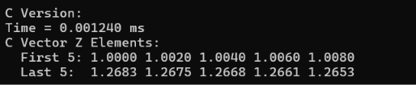
### C Reference Kernel **$n = 2^{20}$** ($1,048,576$)
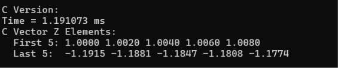
### C Reference Kernel **$n = 2^{20}$ +7** ($1,048,583$) (Boundary)
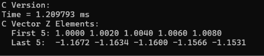
### C Reference Kernel **$n = 2^{26}$** ($67,108,864$)
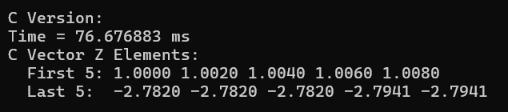
### C Reference Kernel **$n = 2^{28}$** ($268,435,456$)
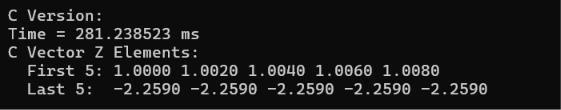

### x86-64 Kernel **$n = 1003$** (Boundary)
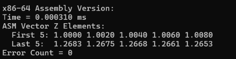
### x86-64 Kernel **$n = 2^{20}$** ($1,048,576$)
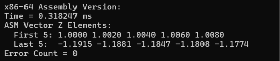
### x86-64 Kernel **$n = 2^{20}$ +7** ($1,048,583$) (Boundary)
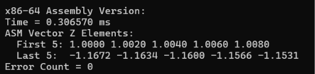
### x86-64 Kernel **$n = 2^{26}$** ($67,108,864$)
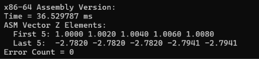
### x86-64 Kernel **$n = 2^{28}$** ($268,435,456$)
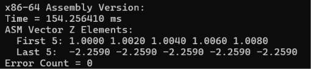

### SIMD XMM Kernel **$n = 1003$** (Boundary)
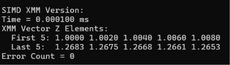
### SIMD XMM Kernel **$n = 2^{20}$** ($1,048,576$)
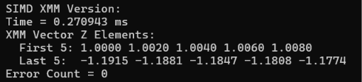
### XMM **$n = 2^{20}$ +7** ($1,048,583$) (Boundary)
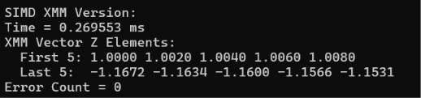
### SIMD XMM Kernel **$n = 2^{26}$** ($67,108,864$)
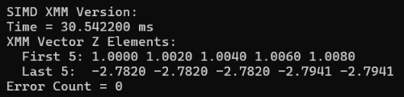
### SIMD XMM Kernel **$n = 2^{28}$** ($268,435,456$)
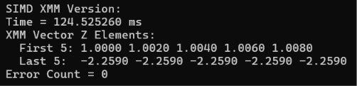

### SIMD YMM Kernel **$n = 1003$** (Boundary)
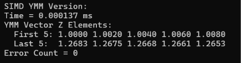
### SIMD YMM Kernel **$n = 2^{20}$** ($1,048,576$)
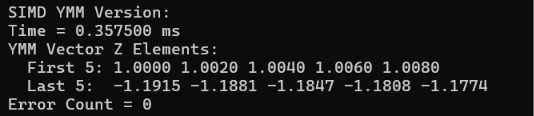
### YMM **$n = 2^{20}$ +7** ($1,048,583$) (Boundary)
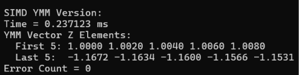
### SIMD YMM Kernel **$n = 2^{26}$** ($67,108,864$)
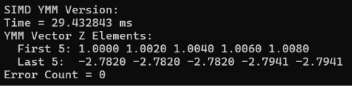
### SIMD YMM Kernel **$n = 2^{28}$** ($268,435,456$)
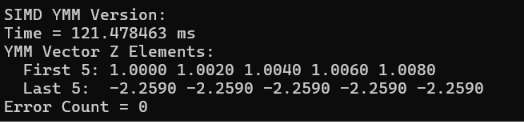
---

## Comparative Performance Table

| Vector Size ($n$) | C Kernel (ms) | x86-64 Assembly (ms) | SIMD XMM (ms) | SIMD YMM (ms) | Speedup (YMM vs C) |
| :--- | :--- | :--- | :--- | :--- | :--- |
| **$n = 1,003$** (Boundary) | `0.001240` | `0.000310` | `0.000100` | `0.000137` | `9.0510x` |
| **$n = 2^{20}$** ($1,048,576$) | `1.191073` | `0.318247` | `0.270943` | `0.357500` | `3.3317x` |
| **$n = 2^{20}$ +7** ($1,048,583$) (Boundary) | `1.209793` | `0.306570` | `0.269553` | `0.237123` | `5.1020x` |
| **$n = 2^{26}$** ($67,108,864$) | `76.6768883 ` | `36.529787` | `30.542200` | `29.432843` | `2.6051x` |
| **$n = 2^{28}$** ($268,435,456$) | `281.238523` | `154.256410` | `124.525260` | `121.478463` | `2.3151x` |

---

## Performance Analysis and Discussion

### 1. Which platform is fastest and why?
* Fastest Kernel - SIMD YMM Assembly showed the fastest performance across all test vector sizes.
* It is faster because the C & x86-64 Scalar Assembly process only 1 float per loop iteration. While the SIMD XMM Assembly processes 4 floats in parallel per instruction. On the other hand, SIMD YMM Assembly processes 8 floats in parallel per instruction, doubling the throughput of XMM and quadrupling scalar operations per cycle.

### 2. Why is speedup not comparable with theoretical limits?
* Memory-Bound Bottleneck - Vector AXPY performs only 2 floating-point operations, which are multiplication and addition, for every 3 memory accesses.
* SIMD instructions process math faster than system RAM can supply input data or write back output data. The CPU spends cycles idling while waiting for memory transfers.
* For large vector sizes, data arrays exceed CPU L1/L2/L3 cache sizes. 
* Boundary sizes add non-vectorized instructions to every pass.
  
---

## Problems Encountered, AHA moments

Problems Encountered:

To handle arbitrary vector sizes where n is not divisible by 4 or 8, we decided to:
* Process the vector elements in blocks of 4 or 8 as long as i + 4 <= n or i + 8 <= n.
* A secondary fallback loop handles any remaining n % 4 or n % 8 elements one by one. This prevents memory access from going out of bounds or incorrect array sizing.

Floating-Point Precision at High Values of n:
* For n = 2^26 and n = 2^28, 32-bit floats lose integer indexing precision during initialization, causing adjacent indices to evaluate to identical floating-point numbers.

AHAness:

Is this memory-bound or compute-bound?
* Memory-Bound - The AXPY kernel performs only 2 floating-point operations, which are multiplication and addition, for every 3 memory accesses. This means memory bandwidth, not CPU ALU cycles, is the primary performance bottleneck.
  
Will SIMD YMM be faster than optimized C?
* Debug: Yes, YMM assembly is significantly faster because debug builds disable compiler auto-vectorization.
* Release: Optimized C reaches close to YMM performance because MSVC auto-vectorizes loops using SIMD instructions.

## AI Disclosure

AI Disclosure:
* Visual Studio Copilot - Used as a sanity check on the code output.
* Grammarly - Used in editing the README.md files for proper grammar.
